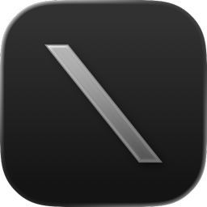
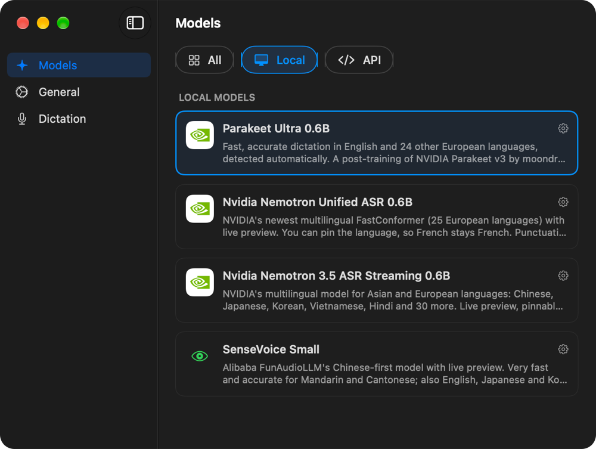

<div align="center">



# Ora

[](https://github.com/ocai-labs/ora/releases/latest)
[](https://github.com/ocai-labs/ora/releases)

[](LICENSE)

**Local, private voice-to-text for macOS.** Hold a hotkey, speak, release —
your words are transcribed on-device and pasted into whatever app you're using.
No cloud round-trip, no account, no telemetry.


<p>
  <a href="https://github.com/ocai-labs/ora/releases/latest/download/Ora.dmg"><b>↓ Download Ora.dmg</b></a>
  &nbsp;·&nbsp;
  <a href="#install">Install</a>
  &nbsp;·&nbsp;
  <a href="#privacy">Privacy</a>
  &nbsp;·&nbsp;
  <a href="#build-from-source">Build from source</a>
</p>

</div>

## What is Ora?

Ora turns your voice into text anywhere on your Mac. Press **Option+Space**,
talk, and release — the transcript lands at your cursor in whatever app has
focus: your editor, browser, chat box, email, terminal. It lives in the menu
bar and stays out of the way until you need it.

Everything runs on Apple Silicon with on-device speech models, so dictation
works offline and your audio never leaves your machine. It's a free,
open-source alternative to the subscription dictation apps — you own the app,
the models, and your data.

## Features

- **Dictate into any app** — the transcript is pasted right where your cursor
  is: editors, browsers, Slack, email, terminals. If you'd rather not auto-paste,
  Ora can just copy to the clipboard instead.
- **Live preview** *(optional)* — switch the dictation display to **Panel** with
  a Parakeet, Nemotron or SenseVoice model and watch the text form in a bubble above the
  pill as you speak. Nothing is typed until you release the key, so your cursor
  and existing text stay untouched.
- **Your choice of models** — on-device **Parakeet Ultra** and **Nemotron Unified**
  (NVIDIA), and **Nemotron 3.5 Streaming** and **SenseVoice** for Chinese,
  Japanese and Korean, or bring
  your own API key for **OpenAI** / **Groq**. Switch any time from Settings.
- **Pin your language** — Nemotron Unified covers 25 European languages and
  Nemotron 3.5 Streaming about 40 (including Mandarin, Japanese and Korean);
  both let you lock the one you speak (say, French), so it doesn't drift into
  English words mid-sentence. Punctuation is built in.
- **Push-to-talk or toggle** — hold the hotkey to dictate, or press once to
  start and again to stop. **Return** also finishes a recording (it isn't
  passed on to the app, so a chat box won't send an empty message). Cancel
  any in-flight dictation with **ESC**.
- **Menu-bar app** — no Dock clutter, no window to manage; just a status-bar icon.
  Its menu has **Copy Last Transcription** in case a paste lands in the wrong place.
- **Private by default** — local models mean zero network calls for
  transcription. No telemetry, no analytics, no crash reporting, ever.
- **Auto-updates** — signed, notarized releases delivered in the background via
  [Sparkle](https://sparkle-project.org).

<div align="center">
  
</div>

## Install

**[→ Download Ora.dmg (latest)](https://github.com/ocai-labs/ora/releases/latest/download/Ora.dmg)**

1. The download starts immediately.
2. Open the DMG and drag **Ora** onto the Applications shortcut.
3. Launch Ora from Applications. On first launch it'll walk you through
   microphone + accessibility permissions and downloading a model.

Ora is signed with a Developer ID and notarized by Apple, so Gatekeeper will
open it without warnings. Updates ship automatically via Sparkle — once
installed, new versions are fetched in the background and you're prompted to
restart.

### Requirements

- macOS 14 (Sonoma) or later, Apple Silicon only
- Microphone permission
- Accessibility permission (so Ora can paste into other apps)

Building from source additionally needs Xcode 26+ — see [Build from source](#build-from-source) below.

## Privacy

Ora is built around a simple rule: **your voice never leaves your Mac.**

- **No network calls for transcription.** On-device Parakeet, Nemotron,
  and SenseVoice models run entirely locally via [FluidAudio](https://github.com/FluidInference/FluidAudio).
  Audio is captured, transcribed, and discarded on your machine.
  *(The optional OpenAI / Groq backends are the one exception — they upload
  audio to that provider, and only if you explicitly choose one.)*
- **No telemetry, no analytics, no crash reporting.** Ora does not phone home
  and has no server-side component. The only outbound network traffic is
  Sparkle checking GitHub for new release DMGs — and you can turn that off in
  Settings.
- **Models live in your own Application Support directory.** Download and delete
  them from Settings; nothing is hidden.

If you're dictating something sensitive and want belt-and-suspenders
confirmation, throw Ora into Little Snitch or disconnect Wi-Fi: transcription
with a local model will keep working exactly the same.

## Build from source

No Apple Developer account required — the project uses ad-hoc signing
(`Sign to Run Locally`) out of the box.

```bash
git clone https://github.com/ocai-labs/ora.git
cd ora
./scripts/dev-launch.sh
```

The script builds the project and launches Ora via Launch Services, so
permission prompts attribute to Ora correctly.

### Dev scripts

| Script | Purpose |
|--------|---------|
| `scripts/dev-launch.sh` | Build and launch via Launch Services — permission prompts attribute to Ora correctly |
| `scripts/dev-run.sh` | Build and launch with stdout/stderr streaming to your terminal (useful for debugging) |
| `scripts/dev-reset.sh` | Wipe TCC entries and UserDefaults for a clean first-run experience |

### Custom code signing (optional)

Only needed if you want to sign with your own Apple Developer identity:

```bash
cp scripts/dev-env.local.sh.example scripts/dev-env.local.sh
# edit with your SIGN_IDENTITY and TEAM values
```

This file is gitignored and will never be committed.

## License

Ora is free software licensed under the [GNU General Public License v3.0](LICENSE).
You may use, study, share, and modify it; derivative works you distribute must
also be released under the GPLv3.

© Ora contributors
